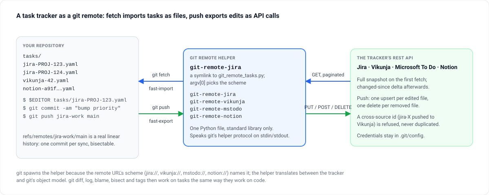

# git-remote-tasks

**Jira, Vikunja, Microsoft To Do and Notion as native git remotes. `git fetch` pulls every task
in as a file under `tasks/`; edit, commit, `git push`, and the tracker changes.**

[](LICENSE)

[Documentation](https://mmdemirbas.github.io/git-remote-tasks/) ·
[Source](https://github.com/mmdemirbas/git-remote-tasks) ·
[Project page](https://mdemirbas.com/en/projects/git-remote-tasks/)



```text
$ git fetch jira-work
$ ls tasks/
jira-PROJ-123.yaml jira-PROJ-124.yaml jira-PROJ-127.yaml
$ $EDITOR tasks/jira-PROJ-123.yaml
$ git add tasks/ && git commit -m "tasks: bump priority"
$ git push jira-work main      # updates the issue on Jira
```

A git remote helper is any executable named `git-remote-<scheme>` on the PATH: git spawns it for
a URL with that scheme and speaks a line protocol over stdin and stdout. This one is a single
Python file, standard library only, that answers to four names through symlinks —
`git-remote-jira`, `git-remote-vikunja`, `git-remote-mstodo`, `git-remote-notion` — and
translates between each tracker's REST API and git's object model.

- **Every sync is a commit** — `refs/remotes/<remote>/main` is a real linear history, so
  `git diff`, `git log`, `git blame`, `git bisect` and tags work on tasks
- **YAML or Org-mode** per repository, chosen at init; both round-trip through one schema
- **Incremental** — a full snapshot on the first fetch, a changed-since delta afterwards; an
  interrupted import never loses data
- **Honest push** — one upsert per edited file, one delete per removed file; a cross-source id
  is refused rather than duplicated, and `git push`'s exit code reflects every failure

## Quick start

```bash
git clone https://github.com/mmdemirbas/git-remote-tasks.git ~/src/git-remote-tasks
python ~/src/git-remote-tasks/git_remote_tasks.py install --bin-dir ~/.local/bin

tasks-init --format yaml ~/work/tasks && cd ~/work/tasks
git remote add vikunja vikunja://localhost:3456
git config tasks-remote.vikunja.scheme    vikunja
git config tasks-remote.vikunja.baseUrl   http://localhost:3456
git config tasks-remote.vikunja.apiToken  $(pass show vikunja/api)

git fetch vikunja
git merge vikunja/main --allow-unrelated-histories   # first time only
$EDITOR tasks/vikunja-42.yaml
git add tasks/ && git commit -m "tasks: raise priority on 42"
git push vikunja main
```

Python 3.10+ and git 2.20+. `msal` is the one optional extra, for Microsoft To Do's device-code
login.

## How it works

1. **Fetch** — git sends `capabilities`, `list`, `import`. The helper decides between a full
   snapshot (`deleteall` and a rebuilt `tasks/` tree) and a delta (`M` for changed files, `D`
   for tombstones), writes a fast-import stream, and records the new `since` token only once
   the tip has advanced.
2. **Push** — git writes a fast-export stream. Each `M` under `tasks/` is deserialised and
   upserted; each `D` is deleted; anything outside `tasks/` is ignored. `ok` or `error` per
   ref, non-zero exit if anything failed.

Credentials live under `[tasks-remote "<name>"]` in `.git/config`, never in the URL. Formats,
every configuration key, per-service setup, troubleshooting and the development loop are in
the [documentation](https://mmdemirbas.github.io/git-remote-tasks/).

## Development

```bash
python -m unittest test_git_remote_tasks                     # default suite, stdlib only
python3 -m venv .venv && .venv/bin/pip install -r requirements-dev.txt
.venv/bin/python -m unittest test_git_remote_tasks test_yaml_parser_fuzz   # + hypothesis fuzz
GRT_LIVE_CONFIG=/path/to/config.yaml python test_live_integration.py       # against live services
```

`GIT_REMOTE_TASKS_DEBUG=1` logs every HTTP call with its elapsed time to stderr, query strings
stripped. See [CONTRIBUTING.md](CONTRIBUTING.md).

## Licence

[MIT](LICENSE)
