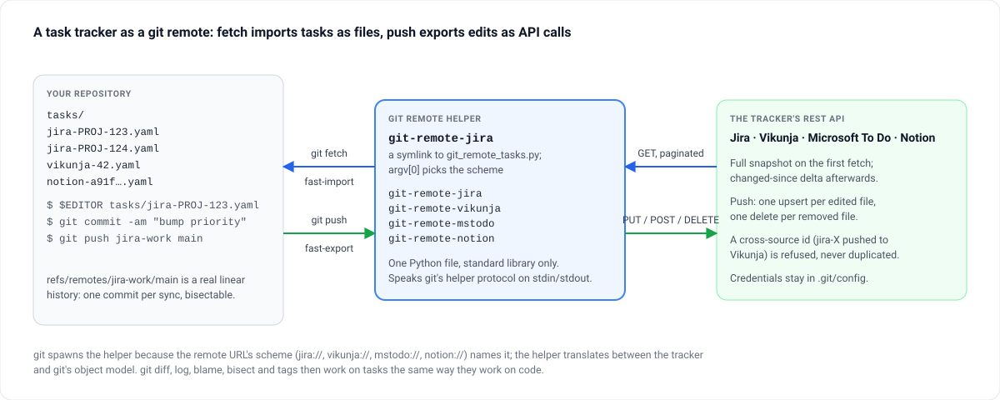

> [!TLDR]
> git spawns `git-remote-<scheme>` for the URL's scheme; fetch becomes a fast-import stream that rebuilds or patches `tasks/`, push becomes a fast-export stream turned into upserts and deletes. Every sync is a real commit on the remote-tracking branch.



```
        ┌──────────────────────┐   stdin    ┌──────────┐   HTTPS    ┌────────┐
  git → │ git-remote-<scheme>  │ ─────────► │  helper  │ ─────────► │ service│
        │  (symlink to .py)    │ ◄───────── │  script  │ ◄───────── │  API   │
        └──────────────────────┘            └──────────┘            └────────┘
                │ stdout (fast-import stream)
                ▼
         git repository
```

### Import (`git fetch`)

1. git spawns the helper with the remote URL and sends `capabilities`,
   `list`, and `import <ref>` on stdin.
2. Helper checks `sync.mode` + `sync.lastFetchAt` + the current
   `<remote>/main` tip to decide between a **full snapshot** and an
   **incremental delta**.
3. Full snapshot: `Driver.fetch_all()` paginates the whole task set
   and the helper writes a `deleteall` fast-import stream that rebuilds
   the `tasks/` tree from scratch.
4. Incremental: `Driver.fetch_changed(since)` returns `(changed,
   deleted, new_since)`. The helper emits per-file `M` directives for
   changed blobs and `D` for tombstones — no `deleteall`, so the
   `git diff` shows only what actually changed upstream.
5. The new `since` token is written back under
   `sync.pending.since` together with the parent sha; it only promotes
   to `sync.lastFetchAt` on the next run if the tip actually advanced.
   An interrupted fast-import never loses data.

### Export (`git push`)

1. git writes a fast-export stream to the helper's stdin.
2. Helper reads `blob` / `commit` / `M` / `D` directives, ignoring
   anything outside `tasks/`.
3. For each `M`, the blob is deserialized back to the unified task
   dict and handed to `Driver.upsert()`.
4. For each `D`, `Driver.delete()` is called.
5. Cross-source ids (`jira-X` in a Vikunja remote, etc.) are refused
   with a driver-specific `PushError` — no silent duplication.
6. Helper responds `ok <ref>` on success, `error <ref> <msg>` on any
   failure, and exits non-zero whenever at least one failure was
   recorded. `git push`'s own exit code reflects reality.

## Git workflow

| Git command                   | Effect                                           |
|-------------------------------|--------------------------------------------------|
| `git fetch <remote>`          | Pulls remote task snapshot into `<remote>/main`. |
| `git diff main <remote>/main` | Shows what changed upstream since last sync.     |
| `git merge <remote>/main`     | Materializes remote tasks into the working tree. |
| `git log -- tasks/`           | Audit trail of every sync + manual edit.         |
| `git push <remote> main`      | Upserts edited tasks; deletes removed files.     |
| `git tag release/2025-W16`    | Snapshots task state at a moment in time.        |

Each sync bases the new commit on the previous remote tip (via
`from <sha>` in the fast-import stream). `refs/remotes/<remote>/main`
accumulates a real linear history; `git bisect` walks every sync.
`git merge <remote>/main` works without `--allow-unrelated-histories`
except on the very first fetch, when the remote-tracking ref is still
a root commit.

## Org-mode tips

- Emacs with `org-mode` highlights `DEADLINE:` lines natively and
  surfaces them in the agenda view.
- Neovim: `nvim-orgmode/orgmode` gives folding and TODO cycling.
- VS Code: `vscode-org-mode` renders drawers and tags cleanly; combine
  with the built-in git panel.
- Org diffs show up in `git diff` as plain text — the headline change
  is usually the first non-context line.
- YAML diffs are one property per line; org diffs group metadata under
  one drawer. On large batches, YAML tends to produce smaller diffs.
