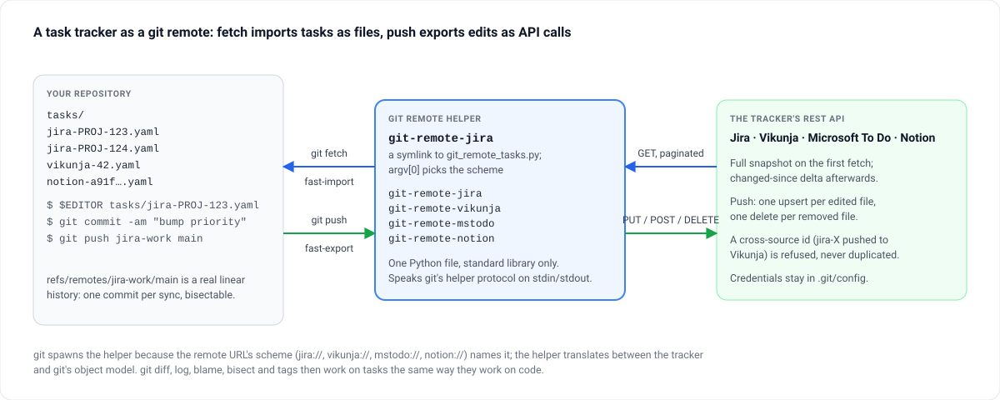

> [!TLDR]
> `git fetch jira-work` turns every issue into `tasks/jira-PROJ-123.yaml`. Edit, commit, `git push jira-work main`, and the issue changes on Jira. One standard-library Python file; four schemes via symlinks.
>
> - Every sync is a commit: `git diff`, `git log`, `git blame`, `git bisect` and tags work on tasks
> - YAML or Org-mode per repository
> - Incremental fetch after the first snapshot; interrupted imports lose nothing

## The idea {#idea}



A git remote helper is any executable named `git-remote-<scheme>` on the PATH. When git sees a remote URL with that scheme it spawns the helper and speaks a line-based protocol over stdin and stdout. This one translates between four task trackers and git's object model, and picks its scheme from its own name — one file, four symlinks.

```text
$ git fetch jira-work
$ ls tasks/
jira-PROJ-123.yaml jira-PROJ-124.yaml jira-PROJ-127.yaml
$ $EDITOR tasks/jira-PROJ-123.yaml
$ git add tasks/ && git commit -m "tasks: bump priority"
$ git push jira-work main      # updates the issue on Jira
```

## What you get from git {#git}

```oku-table
{"headers":["Git command","Effect on tasks"],"rows":[["`git fetch <remote>`","Pulls the remote's tasks into `<remote>/main` — a full snapshot the first time, a changed-since delta afterwards"],["`git diff main <remote>/main`","What changed upstream since the last sync"],["`git merge <remote>/main`","Materialises remote tasks into the working tree"],["`git log -- tasks/`","An audit trail of every sync and every manual edit"],["`git push <remote> main`","Upserts edited tasks; deletes removed files"],["`git tag release/2025-W16`","A snapshot of the task state at a moment in time"]]}
```

## Where to go next {#next}

```oku-compare-grid
{"cards":[{"t":"Getting started","b":"Install the symlinks, add a remote, fetch, edit, push.","href":"getting-started.html"},{"t":"Formats, URLs, configuration","b":"YAML or Org, the URL shape, every config key.","href":"formats.html"},{"t":"Service setup","b":"Tokens and ids for the four trackers.","href":"services.html"},{"t":"How it works","b":"The protocol, import and export, the git workflow.","href":"how-it-works.html"}]}
```
